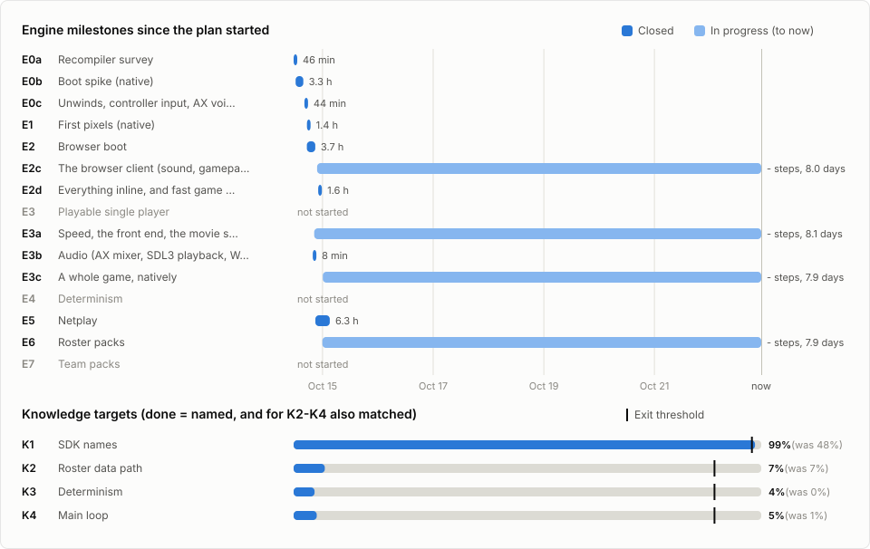
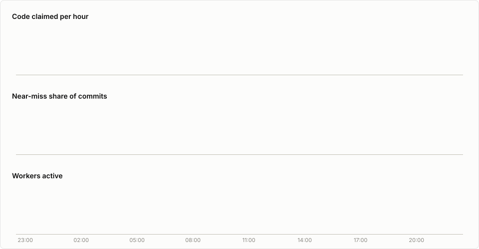

# MVP Baseball 2005: live dashboard

**Updated Thu Oct 22, 22:21 CDT.** Refreshed about every minute while the owner's PC is on, by [`tools/fleet_dashboard.py`](https://github.com/ptitty12/mvp2005-decomp/blob/main/tools/fleet_dashboard.py) reading git history. The overall progress card is on the [main README](https://github.com/ptitty12/mvp2005-decomp#progress).

## Browser plan

- **Day 9 of the browser plan** (adopted Wed Oct 14 11:27, 8.5 days ago).
- **Engine:** 5 of 9 roadmap milestones closed (E0a, E0b, E1, E2, E5), plus the E0c, E2d, E3b follow-ups. In progress: E2c The browser client (sound, gamepad, the disc from the server, caching, polish): - steps, last commit Wed Oct 14 22:14; E3a Speed, the front end, the movie specks: - steps, last commit Wed Oct 14 22:55; E3c A whole game, natively: - steps, last commit Thu Oct 15 02:50; E6 Roster packs: - steps, last commit Thu Oct 15 01:19.
- **Next exit (E3):** A full 9-inning exhibition against the CPU: no crash, sound plays, steady frame pacing.
- **Engine code:** 80,069 lines on `main` with 258 test cases. 271 engine commits since the plan started, 0 in the last hour.
- **Knowledge:** K1 SDK names 99% (exit met); K2 Roster data path 7%; K3 Determinism 4%; K4 Main loop 5%.

### Engine milestones

From [`docs/ROADMAP.md`](https://github.com/ptitty12/mvp2005-decomp/blob/main/docs/ROADMAP.md#4-milestones) and the logs in [`docs/engine/`](https://github.com/ptitty12/mvp2005-decomp/tree/main/docs/engine). Times are first tagged commit and close.

| | Milestone | State | Steps | Started | Closed | Took | Exit |
|---|---|---|---:|---:|---:|---:|---|
| **E0a** | Recompiler survey | Closed | - | Wed Oct 14 11:27 | Wed Oct 14 12:13 | 46 min | `docs/engine/E0_SURVEY.md` exists, and decisions D1-D2 (`ARCHITECTURE.md` §9) are recorded in `docs/DECISIONS.md` |
| **E0b** | [Boot spike (native)](https://github.com/ptitty12/mvp2005-decomp/blob/main/docs/engine/E0B_LOG.md) | Closed | 10/10 | Wed Oct 14 12:19 | Wed Oct 14 15:38 | 3.3 h | The game runs from `__start` through `main` into its frame loop and reaches the first VI retrace. A log lists every SDK call by name |
| **E0c** | [Unwinds, controller input, AX voices (E0 follow-ups)](https://github.com/ptitty12/mvp2005-decomp/blob/main/docs/engine/E0C_LOG.md) | Closed | 3/3 | Wed Oct 14 16:06 | Wed Oct 14 16:50 | 44 min | - |
| **E1** | [First pixels (native)](https://github.com/ptitty12/mvp2005-decomp/blob/main/docs/engine/E1_LOG.md) | Closed | 6/6 | Wed Oct 14 17:13 | Wed Oct 14 18:35 | 1.4 h | The EA logo and the title screen render recognizably |
| **E2** | [Browser boot](https://github.com/ptitty12/mvp2005-decomp/blob/main/docs/engine/E2_LOG.md) | Closed | 9/9 | Wed Oct 14 17:11 | Wed Oct 14 20:51 | 3.7 h | Title screen in Chrome from a cold load, with no game-derived bytes fetched from any server |
| **E2c** | [The browser client (sound, gamepad, the disc from the server, caching, polish) (E2 follow-ups)](https://github.com/ptitty12/mvp2005-decomp/blob/main/docs/engine/E2C_LOG.md) | **In progress** | - | Wed Oct 14 21:37 | - | 8.0 days so far | - |
| **E2d** | [Everything inline, and fast game code in the browser (E2 follow-ups)](https://github.com/ptitty12/mvp2005-decomp/blob/main/docs/engine/E2D_LOG.md) | Closed | 6/6 | Wed Oct 14 22:05 | Wed Oct 14 23:42 | 1.6 h | - |
| **E3** | Playable single player | Not started | - | - | - | - | A full 9-inning exhibition against the CPU: no crash, sound plays, steady frame pacing |
| **E3a** | [Speed, the front end, the movie specks (E3 follow-ups)](https://github.com/ptitty12/mvp2005-decomp/blob/main/docs/engine/E3A_LOG.md) | **In progress** | - | Wed Oct 14 20:23 | - | 8.1 days so far | - |
| **E3b** | [Audio (AX mixer, SDL3 playback, WAV dumps) (E3 follow-ups)](https://github.com/ptitty12/mvp2005-decomp/blob/main/docs/engine/E3B_LOG.md) | Closed | 6/6 | Wed Oct 14 19:45 | Wed Oct 14 19:53 | 8 min | - |
| **E3c** | [A whole game, natively (E3 follow-ups)](https://github.com/ptitty12/mvp2005-decomp/blob/main/docs/engine/E3C_LOG.md) | **In progress** | - | Thu Oct 15 00:05 | - | 7.9 days so far | - |
| **E4** | Determinism | Not started | - | - | - | - | A recorded 3-inning game replays with identical hashes on two runs, and on two different machines/browsers |
| **E5** | [Netplay](https://github.com/ptitty12/mvp2005-decomp/blob/main/docs/engine/E5_LOG.md) | Closed | 7/7 | Wed Oct 14 20:54 | Thu Oct 15 03:10 | 6.3 h | Two players on different networks finish an exhibition game |
| **E6** | [Roster packs](https://github.com/ptitty12/mvp2005-decomp/blob/main/docs/engine/E6_LOG.md) | **In progress** | - | Wed Oct 14 23:55 | - | 7.9 days so far | A pack that changes a team's roster is chosen in the lobby, and both players play with it |
| **E7** | Team packs | Not started | - | - | - | - | A custom team, in a replaced slot, plays a netplay game |

### Knowledge targets

From [`tools/goals/targets.py`](https://github.com/ptitty12/mvp2005-decomp/blob/main/tools/goals/targets.py) on the progress bot's build of `main` at Wed Oct 21 10:13. K1 is done when named; K2-K4 when matched and named.

| Target | Functions | Named | Matched | Done | At plan start | Exit | Needed by |
|---|---:|---:|---:|---:|---:|---:|---|
| K1 SDK names | 299 | 295 | 251 | 295 (99%) | 48% | ≥ 98% (met) | E0b |
| K2 Roster data path | 60 | 4 | 57 | 4 (7%) | 7% | ≥ 90% | E6, E7 |
| K3 Determinism | 201 | 13 | 137 | 9 (4%) | 0% | ≥ 90% | E4 |
| K4 Main loop | 81 | 5 | 73 | 4 (5%) | 1% | ≥ 90% | - |

## Matching fleet

General matching is paused outside the knowledge targets ([ROADMAP](https://github.com/ptitty12/mvp2005-decomp/blob/main/docs/ROADMAP.md) §5, 2026-10-14); this tracks the matching that still runs. *Verified* numbers come from the progress bot's build of `main` (last one at -). *Claimed* numbers are worker commits that may not be merged or verified yet.

- No verified progress in the last 48 h.
- No worker commits in the last 48 h.

### Speed

|  | 15 min | 1 h | 3 h |
| --- | ---: | ---: | ---: |
| Code verified on main / h | - | - | - |
| Functions verified / h | - | - | - |
| Code claimed by workers / h | 0.0 KB | 0.0 KB | 0.0 KB |
| Functions claimed / h | 0 | 0 | 0 |
| Near-miss share of commits | - | - | - |
| Commits / h | 0 | 0 | 0 |
| Workers active | 0 | 0 | 0 |
| Code claimed / h per worker | - | - | - |

### Workers

| Slot | Batch | State | Last commit | Last build | Commits (1 h) | Near-miss (1 h) | Waiting to merge | Last commit subject |
| --- | --- | --- | ---: | ---: | ---: | ---: | ---: | --- |
| W1 | `names-02` | idle | - | 15:15 | 0 | 0 | 0 |  |
| W10 | `hard-08` | idle | - | 21:55 | 0 | 0 | 0 |  |
| W11 | `hard-09` | idle | - | 21:48 | 0 | 0 | 0 |  |
| W12 | `decl-02` | idle | - | 21:39 | 0 | 0 | 0 |  |
| W2 | `k1c-finish` | idle | - | 17:00 | 0 | 0 | 0 |  |
| W3 | `k-03` | idle | - | 14:06 | 0 | 0 | 0 |  |
| W4 | `k-04` | idle | - | 13:56 | 0 | 0 | 0 |  |
| W5 | `k-05` | idle | - | 13:37 | 0 | 0 | 0 |  |
| W6 | `hard-04` | idle | - | 21:57 | 0 | 0 | 0 |  |
| W7 | `hard-05` | idle | - | 21:29 | 0 | 0 | 0 |  |
| W7s3 | `p6-14` | idle | - | 00:07 | 0 | 0 | 0 |  |
| W8 | `hard-06` | idle | - | 21:29 | 0 | 0 | 0 |  |
| W9 | `hard-07` | idle | - | 22:05 | 0 | 0 | 0 |  |
| match | `opus-families-7` | idle | - | 10:46 | 0 | 0 | 0 |  |

**Merge backlog:** 8 commits on 2 branches, oldest from 17:09. Last merge into `main` at 10:05.

### Close to matching

Functions below 100% in the build of `main` at 10:13.

| Match | Functions | Code |
| --- | ---: | ---: |
| >= 99% | 205 | 86.4 KB |
| 95-99% | 305 | 121.1 KB |
| 80-95% | 323 | 81.9 KB |

| Closest | Match | Size | Unit |
| --- | ---: | ---: | --- |
| `tBigYUVSwizzler_DrawSetup` | 99.99% | 1,680 B | `ealib/tu_8038BC58` |
| `fn_803E7A60` | 99.98% | 1,064 B | `ealib/tu_803E6FB8` |
| `fn_8028D200` | 99.98% | 740 B | `animation/goals/tu_8028C6B8` |
| `fn_801F0004` | 99.98% | 368 B | `game/tu_801EE438` |
| `fn_8013F60C` | 99.96% | 652 B | `game/tu_8013BE4C` |
| `fn_8025AC0C` | 99.96% | 424 B | `game/tu_8025877C` |
| `fn_800F6F0C` | 99.95% | 376 B | `game/tu_800F56B4` |
| `fn_800653F8` | 99.94% | 772 B | `game/tu_80064D48` |
| `fn_804B3110` | 99.93% | 292 B | `fe/tu_804B13FC` |
| `fn_80492FB4` | 99.93% | 324 B | `fe/tu_80492680` |

### Permuter farm

Unattended decomp-permuter runs over main's near-misses at idle CPU priority (`tools/match/permute_farm.py`). A match candidate is confirmed by rebuilding its unit and waits as a patch for a worker to apply and verify.

idle; queue 0; tried 553: 7 match candidates, 223 improved, 159 refused

| Match candidate | Unit | Was |
| --- | --- | ---: |
| `fn_8035FD1C` | `game/tu_8035F63C` | 97.30% |
| `OSInitAlloc` | `dolphin/os/tu_804321CC` | 98.93% |
| `fn_8001B2F0` | `game/tu_8001B190` | 99.37% |
| `fn_803F113C` | `ealib/tu_803F00FC` | 99.76% |
| `fn_803F1204` | `ealib/tu_803F00FC` | 99.77% |
| `fn_804707B8` | `fe/tu_8046F770` | 99.88% |
| `fn_80573FB8` | `db/tu_805721F8` | 99.91% |

Code claimed per hour behind the chart: 
